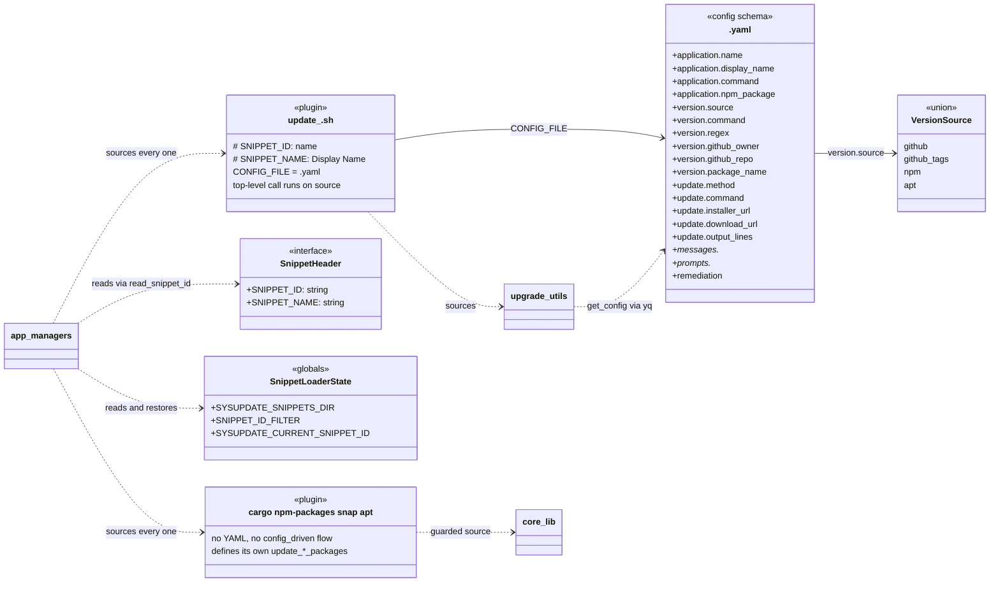
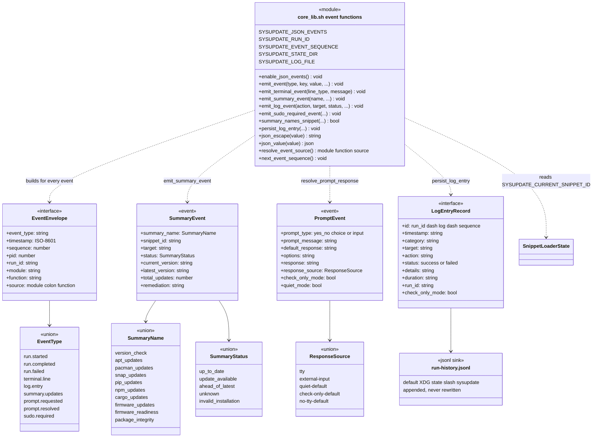
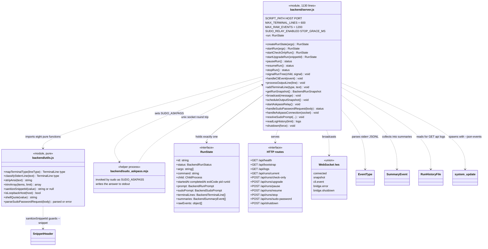
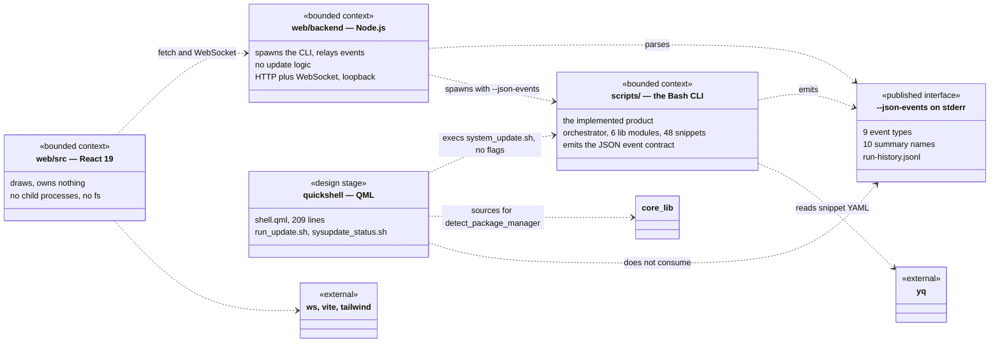

# sysupdate — UML class diagram

```
┌─────────────────────────────────────────────────────────────────────────────────────────────┐
│ Name         uml-class-diagram                                                              │
│ Type         UML class diagram — static structure, extracted from source                    │
│ Project      sysupdate                                                                      │
│ Description  The declared types of all three bounded contexts and the relationships between │
│              them: the sourced Bash modules that are the product, the config-driven snippet  │
│              plugin protocol and its YAML schema, the JSON event contract that is the only   │
│              published interface, the Node.js bridge that spawns the CLI, and the React      │
│              dashboard that draws it. Extracted from scripts/, web/backend, web/src and      │
│              quickshell/ at commit f442b24.                                                  │
└─────────────────────────────────────────────────────────────────────────────────────────────┘
```

## Read this first: what "class" means in this codebase

A faithful extraction finds **zero classes in the product**.

The implemented product is 5,965 lines of Bash across `scripts/` plus 11,892 lines of snippets.
Bash has no classes, no objects and no namespaces: it has files you `source` into one shared
shell, free functions, and global variables. The two front-ends add TypeScript and JavaScript,
and neither declares a `class` either — `web/backend/server.js` is module-scoped functions over
one mutable `run` record, and all eight components in `web/src/components/` are function
components.

| Declaration kind | Count | Where |
|---|---|---|
| Bash function names | **489** (495 definition sites) | 60 files under `scripts/` |
| Bash sourced modules | 6 lib + 48 snippets | [`scripts/lib/`](../../scripts/lib), [`scripts/upgrade_snippets/`](../../scripts/upgrade_snippets) |
| YAML snippet configs | 39 | `scripts/upgrade_snippets/*.yaml` |
| TypeScript `interface` / `type` | 19 exported + 8 prop interfaces | [`web/src/types.ts`](../../web/src/types.ts), `web/src/components/*.tsx` |
| React function components | 11 | 8 default-exported views, 2 private (`UpdateItemCard`, `Toggle`), plus `App` |
| JS/TS `class` | **0** | — |
| Bash `class` | **0** (not a language feature) | — |

So the diagrams below use UML stereotypes — `«module»`, `«interface»`, `«union»`, `«config
schema»`, `«event»`, `«globals»` — rather than pretending a sourced Bash file is a class. That is
not a limitation of the extraction; it follows from the one architectural rule the repo states
about itself: **`system_update.sh` is a thin orchestrator with no business logic, and the
front-ends are clients of the JSON event contract rather than re-implementations of update
logic.** A class diagram's job here is to show where that rule holds and where it does not.

Two things a class diagram can show about Bash that prose keeps getting wrong, and both appear
below: every sourced file shares **one** global namespace (so a module is a mixin, not an object),
and the only real encapsulation boundary in the whole system is a **process boundary** — the
`--json-events` stream on stderr.

Rendered and parsed with mermaid **11.17.2**.

## 1. `scripts/lib/` — the sourced core

```mermaid
classDiagram
    direction TB

    class system_update["system_update.sh"] {
        <<orchestrator>>
        SCRIPT_VERSION = 0.5.0
        QUIET_MODE SIMPLE_MODE FULL_MODE
        CLEANUP_ONLY CHECK_ONLY_MODE JSON_EVENTS
        SNIPPET_ID_FILTER LIST_SNIPPETS LOG_HISTORY
        PKG_MANAGER ORIGINAL_ARGS RUN_STARTED_AT
        +usage() void
        +show_version() void
        +list_all_packages(detailed) void
        +show_log_history() void
        +emit_run_lifecycle_event(type, exit_code) void
        +resolve_run_action() string
        +resolve_run_target() string
        +format_run_duration(seconds) string
        +handle_run_exit() void
    }
    class core_lib["lib/core_lib.sh"] {
        <<module>>
        RED GREEN YELLOW BLUE CYAN MAGENTA NC
        +print_status print_success print_warning print_error
        +print_operation_header print_section_header
        +prompt_yes_no(q, default) bool
        +prompt_choice(q, options, default) string
        +prompt_input(q, default, options) string
        +resolve_prompt_response(...) byref
        +ask_continue() void
        +detect_package_manager() apt or pacman
        +compare_versions(a, b) 0 1 or 2
        +normalize_version_for_comparison(v) string
        +run_with_sudo(...) status
        +sudo_can_run() bool
        +enable_sudo_askpass_shim() void
        +ensure_user_paths() void
        +run_with_visible_output(...) status
    }
    class apt_manager["lib/apt_manager.sh"] {
        <<module>>
        +update_package_list() void
        +check_unattended_upgrades() void
        +check_updates_available() 0 or 1
        +upgrade_packages() void
        +full_upgrade() void
        +cleanup() void
        +check_broken_packages() void
        +run_apt(...) status
        +apt_classify_upgrade_failure(log) reason
        +apt_recover_from_dependency_failure(...) status
        +apt_disable_broken_repositories(...) status
        +apt_extract_kept_back_packages(log) list
        +list_partially_installed_packages() list
    }
    class pacman_manager["lib/pacman_manager.sh"] {
        <<module>>
        +check_pacman_config() void
        +update_pacman_database() void
        +check_pacman_updates() void
        +upgrade_pacman_packages() void
        +clean_pacman_cache() void
        +remove_pacman_orphans() void
        +list_pacman_packages() void
    }
    class dpkg_manager["lib/dpkg_manager.sh"] {
        <<module>>
        +maintain_dpkg_packages() void
    }
    class app_managers["lib/app_managers.sh"] {
        <<module>>
        +read_snippet_id(file) string
        +source_upgrade_snippets() void
        +source_snippet_isolated(file) status
        +list_upgrade_snippets() void
        +install_nodejs() void
        +check_nodejs_update() void
    }
    class upgrade_utils["lib/upgrade_utils.sh"] {
        <<module>>
        version 1.4.0, 1966 lines, 65 functions
        +get_config(key, file) string
        +config_driven_version_check() status
        +handle_update_prompt(name, status, cb) status
        +handle_installer_script_update() status
        +handle_deb_package_update() status
        +compare_and_report_versions(cur, latest, name) 0 1 or 2
        +get_github_latest_version(owner, repo) version
        +get_github_latest_tag(owner, repo) version
        +get_npm_latest_version(pkg) version
        +get_apt_latest_version(pkg) version
        +apt_resolve_latest_version(pkg) version
        +select_highest_semver_tag() version
        +extract_version(text, regex) version
        +ensure_npm_healthy() status
        +check_build_dependencies(deps) status
    }

    system_update ..> core_lib : sources
    system_update ..> app_managers : sources
    system_update ..> apt_manager : sources
    system_update ..> pacman_manager : sources
    system_update ..> dpkg_manager : sources
    apt_manager ..> core_lib : guarded source
    pacman_manager ..> core_lib : guarded source
    dpkg_manager ..> core_lib : guarded source
    app_managers ..> core_lib : guarded source
    upgrade_utils ..> core_lib : guarded source
    system_update ..> upgrade_utils : never sources
```



Four relationships carry the design, and the last one is the surprising one.

- **Every arrow out of a module points at `core_lib.sh` and nowhere else.** No
  package-manager module depends on another, so adding a package manager means adding
  `lib/<name>_manager.sh` and one branch in the orchestrator. The probe in §7 confirms there is no
  cross-module edge in either direction.
- **`guarded source` is not an import.** Each module opens with
  `if [ -z "$BLUE" ]; then source core_lib.sh; fi` — nine files do
  ([`app_managers.sh:13`](../../scripts/lib/app_managers.sh#L13) and seven more). It tests whether
  a *colour variable* is already set, which is a test for "has anyone sourced core_lib into this
  shell yet". There is no module identity and no idempotent-import mechanism; `$BLUE` is the
  sentinel. That makes the modules mixins over one shared global namespace, which is why the boxes
  above list globals as members.
- **`system_update.sh` does not source `upgrade_utils.sh`.** The largest module in the repo
  (1,966 lines, 65 functions) is reachable only because 44 of the 48 snippets source it
  themselves. The orchestrator's five `source` lines are the whole of its dependency list
  ([`system_update.sh:59-63`](../../scripts/system_update.sh#L59)).
- **`handle_run_exit` is installed as an `EXIT` trap**, not called. It is the one function in the
  orchestrator that always runs, and it is what makes `run.completed` / `run.failed` and the
  persisted `log.entry` unconditional — including when a snippet kills the shell.

## 2. The snippet plugin protocol

48 snippets, discovered by glob, identified by a header comment, configured by a sibling YAML.
Nothing registers and nothing is wired into the orchestrator.



The population, counted rather than described:

| Snippet shape | Count | What it means |
|---|---|---|
| snippets in `upgrade_snippets/*.sh` | **48** | every one is sourced on every full run |
| source `lib/upgrade_utils.sh` | 44 | the framework is near-universal |
| set `CONFIG_FILE` (and have a sibling YAML) | 39 | config-driven, 1:1 with the 39 `*.yaml` files |
| call `config_driven_version_check` | **24** | the documented standard flow — exactly half |
| no YAML at all | 4 | `cargo_manager.sh`, `npm_manager.sh`, `snap_manager.sh`, `update_apt.sh` |

So **15 snippets read YAML through `get_config` but run their own version-check flow** rather than
the framework's. That is the live divergence pressure in this context: `firefox`, `gdb`, `postman`,
`claude-desktop`, `oh-my-zsh`, `bash`, `gcc-src`, `httpinspect`, `fwupd`, `zsh`, `cursor`,
`oh-my-bash`, `ghostty`, `vscode-insiders` and `pip` each keep a private variant of the same four
steps. The YAML keys measure the same thing from the other side: `messages.*` is **336 of the 596**
`get_config` call sites (56%), which is a sign the schema is mostly externalised strings, not
externalised behaviour.

### Two mechanisms the plugin protocol needs because it has no module boundary

Snippets are `source`d into the orchestrator's **own shell**, so a snippet is not isolated from
its siblings. Two functions exist solely to fake what a module system would have given for free,
and both live in [`source_snippet_isolated`](../../scripts/lib/app_managers.sh#L55):

- **Shell-option restore.** `set -e`, `set -u` and `set -o pipefail` are shell-global, not
  file-local. A snippet that turns `nounset` on leaves it on for every snippet sourced after it and
  for the orchestrator itself. The comment in the source records the failure that produced this
  function: four earlier snippets had enabled `nounset`, SDKMAN's own `sdk` function reads an unset
  `$2`, and an unbound variable ends a non-interactive shell outright — taking the rest of the run,
  the dist-upgrade and the cleanup with it. `$-` is saved and put back around every `source`.
- **Snippet-id tagging.** `SYSUPDATE_CURRENT_SNIPPET_ID` is set from the file's own header for the
  duration of the source and then restored, so every `summary.updates` event carries the id of the
  snippet that produced it without a per-snippet change. Without it a consumer could only act on a
  hardcoded set of targets. Two integration tests hold exactly this: *"each summary carries its own
  snippet id, not the previously sourced one"* and *"a filtered run tags the summary with the
  filtered snippet id"*.

`update_apt.sh` is a third mechanism of the same kind. It exposes the orchestrator's APT flow under
`--snippet apt` so a client acting by id can reach it, but because every snippet is also sourced
during a normal run, it returns immediately unless `SNIPPET_ID_FILTER` is literally `apt` — a
deliberate no-op that prevents a duplicate `apt_updates` event.

## 3. `core_lib.sh` — the event contract, which is the only published interface



The contract's shape is worth three notes, because each is a decision that constrains every
consumer:

- **stderr is the channel.** Human output stays on stdout; every JSON line goes to stderr
  ([`core_lib.sh:129`](../../scripts/lib/core_lib.sh#L129)). This is the only encapsulation
  boundary in the system that a caller cannot reach around: a consumer sees events, not functions
  and not globals. It is also why `run_with_visible_output` exists — a long build's own progress
  would otherwise be lost on the stdout the bridge ignores.
- **`module` / `function` / `source` are computed, not passed.** `resolve_event_source` walks
  `BASH_SOURCE` and `FUNCNAME` and returns the first frame that is neither `core_lib.sh` nor
  `upgrade_utils.sh`, so an event names the snippet or manager that caused it rather than the
  helper that formatted it. The two skipped filenames are hardcoded there — the stack walk is the
  one place where a module's *name* matters to the system.
- **`json_value` infers the JSON type from the string.** Anything matching `-?[0-9]+(.[0-9]+)?`,
  or `true`/`false`/`null`, is emitted bare; everything else is quoted. So a version string is a
  string and a count is a number without either caller declaring it — and a version that happens
  to look like `1.4` is emitted as the number `1.4`. Consumers parse `total_updates` as a number
  and `current_version` as either.

## 4. `web/backend/` — the bridge



The bridge is the place where the architectural rule is actually tested, and it holds: `server.js`
contains no update logic. It spawns `system_update.sh --json-events`, parses the stderr JSONL into
`run.terminalLines` and `run.summaries`, and serves snapshots. The `pure / effectful` split the
Node.js guide asks for is real and measurable — `utils.js` is 97 lines of eight total functions
with no I/O, and it is where the two boundary validations live:

- **`sanitizeSnippetId`** is the only thing between a request body and a CLI argument. The backend
  suite holds it from three directions: spaces rejected, path traversal rejected, missing id
  rejected, each → 400.
- **`isLoopbackHost`** gates the sudo relay. `SUDO_RELAY_ENABLED` is false unless the bridge bound
  a loopback address, so a bridge reachable from the network cannot be asked to collect a password.
  `supports` in `/api/bootstrap` advertises `sudo-askpass` only when that is true, and a test holds
  that too.

The sudo path is the most intricate thing in the repo and the diagram flattens it, so stated
plainly: the CLI calls `sudo`, which cannot prompt without a TTY, so `enable_sudo_askpass_shim`
puts a `sudo` wrapper that adds `-A` first on `PATH` (sudo-rs never falls back to the helper on its
own), `sudo` invokes `sudo_askpass.mjs`, that helper opens a unix socket back to the bridge, the
bridge raises a `BackendSudoPrompt` in the snapshot, the dashboard shows a modal, and the answer
travels back down the socket. The password never enters a snapshot. `rejected: true` is how the
dashboard learns sudo asked the same invocation again.

## 5. `web/src/` — the React layer

```mermaid
classDiagram
    direction TB

    class App["App.tsx, 1149 lines"] {
        <<react component>>
        -activeView: ViewName
        -activeCategory: SidebarCategory
        -updateItems: UpdateItem[]
        -logs: LogEntry[]
        -scheduleTasks: ScheduleTask[]
        -config: SystemConfig
        -terminalLines: TerminalLine[]
        -currentRun: BackendRunSnapshot
        -autoUpdateIds: Set~string~
        -hideUpToDate: boolean
        -isProcessing: boolean
        -shutdownState sudoAnswer
        -websocketRef autoUpgradeQueueRef
        -attemptedAutoUpgradeRef handledScanIdRef
        +handleUpgrade(id) void
        +handleCheckUpdates() void
        +handleRunAll() void
        +handleRefresh() void
        +handleSudoSubmit(password) void
        +handleShutdown() void
        +handleToggleAutoUpdate(id) void
        +handleToggleHideUpToDate() void
    }
    class TopAppBar {
        <<react component>>
        +activeView runStatus progress
        +onViewChange onRefresh onRunAll
        +onStop onTogglePause onShutdown
    }
    class Sidebar {
        <<react component>>
        SIDEBAR_ITEMS: all system node python rust apps
        +activeCategory updateItems isChecking
        +onCategoryChange onCheckUpdates
        -pendingCount(items, category) number
    }
    class DashboardView {
        <<react component>>
        +items terminalLines isProcessing
        +autoUpdateIds hideUpToDate pendingTotal
        +onUpgrade onToggleAutoUpdate onToggleHideUpToDate
    }
    class UpdateItemCard {
        <<react component, private>>
        one card per UpdateItem
    }
    class LogsView {
        <<react component>>
        +logs themeColor
    }
    class ScheduleView {
        <<react component>>
        +tasks onToggle onRunNow
    }
    class SettingsView {
        <<react component>>
        +config onChange scheduleTasks
    }
    class SudoPasswordModal {
        <<react component>>
        +prompt submitting error
        +onSubmit onCancel
    }
    class ShutdownScreen {
        <<react component>>
        +closeAttempted themeColor
    }
    class updateCard["updateCard.ts"] {
        <<module, pure>>
        +toCardAffordances(item, ...) CardAffordances
        +pruneAutoUpdateIds(ids, items) Set
        DEFAULT_BLOCKED_REMEDIATION
        SELF_MANAGED_AUTO_UPDATE_NOTE
        NO_SNIPPET_AUTO_UPDATE_NOTE
    }
    class summaryStatus["summaryStatus.ts"] {
        <<module, pure>>
        +toUpdateStatus(status) UpdateItem status
        +toSeverity(status, totalUpdates) severity
        +toManagerVersionLabels(...) labels
    }
    class updateFilter["updateFilter.ts"] {
        <<module, pure>>
        +filterUpdateItems(items, filter) items
        +countHiddenUpToDate(items, filter) number
        +isUpToDate(item) bool
    }
    class runControls["runControls.ts"] {
        <<module, pure>>
        +getRunControlState(status) RunControlState
        +isRunActiveStatus(status) bool
    }
    class theme["theme.ts"] {
        <<module, pure>>
        +getThemeColorHex getThemeGlowClass
        +getSeverityColor getActionToneColor
        +getFontSizeClass
    }
    class UpdateItem {
        <<interface>>
        +id name snippetId category
        +currentVersion latestVersion typeLabel
        +status: ready up_to_date updating failed self_managed or blocked
        +severity: info minor or major
        +description changelog remediation
    }
    class mockData["data/mockData.ts"] {
        <<module>>
        mockScheduleTasks mockSystemConfig
        mockUpdateItems mockLogEntries
        mockStartupTerminalLines
    }

    App *-- TopAppBar
    App *-- Sidebar
    App *-- DashboardView
    App *-- LogsView
    App *-- ScheduleView
    App *-- SettingsView
    App *-- SudoPasswordModal
    App *-- ShutdownScreen
    DashboardView *-- UpdateItemCard
    UpdateItemCard ..> updateCard : toCardAffordances
    App ..> summaryStatus : maps summary events
    App ..> updateFilter : filters and counts
    App ..> runControls : derives button state
    App ..> theme
    Sidebar ..> theme
    App ..> UpdateItem : builds from SummaryEvent
    DashboardView ..> UpdateItem
    App ..> mockData : scheduleTasks and config only
    App ..> HttpApi : fetch
    App ..> WsApi : WebSocket
    App ..> BackendRunSnapshot : the whole run state
```



`App.tsx` is the one place the rule is under pressure, and the diagram is the argument for
extracting it: it holds **13 pieces of state and 8 refs**, and six of the eight
(`autoUpgradeQueueRef`, `autoUpgradeInProgressRef`, `handledScanIdRef`, `advancedRunIdRef`,
`runNextAutoUpgradeRef`, `attemptedAutoUpgradeRef`) exist to sequence the auto-upgrade queue — an effect-heavy orchestration
that is not a rendering concern. The five pure modules alongside it are the counter-pressure, and
they work: every one has a sibling `.test.ts`, and `toCardAffordances` is where "may this card
offer a retry?" is decided once rather than in JSX.

Two type-level decisions in [`types.ts`](../../web/src/types.ts) are load-bearing:

- **`status: 'blocked'`** means the install itself is broken or the host is out of room. The
  snippet cannot fix it, so the card must not offer a retry — and `remediation` is taken
  *verbatim* from the CLI's event field. The dashboard never invents one. The integration suite
  holds the CLI end: *"summary.updates carries the remediation text verbatim"*.
- **`SystemConfig.repositories`** is `{ apt, pacman, npm, pip, cargo }`, and the source comment
  records that this was corrected from `DESIGN.md`'s `{ brew, apt, npm, pip, cargo }` — the project
  has no Homebrew support and does have pacman. A design document had described a package manager
  the CLI never had.

## 6. Cross-context dependency



The arrow that matters is the one labelled **does not consume**. Both front-ends are described —
in [`CLAUDE.md`](../../CLAUDE.md) and in the [Low Coupling guide](../guides/LOW_COUPLING_GUIDE.md)
— as *clients of the CLI's JSON event contract rather than re-implementations of update logic*.
That is true of `web/`, and it is false of `quickshell/`. See §7.

## 7. What drawing this found

Three findings came out of the extraction, in the order the probes produced them. All three were
measured on `f442b24` before anything was changed, and nothing in this commit fixes them — this
document reports, it does not repair.

### 7.1 Seven defined-and-never-called Bash functions

A call-graph walk over the function definitions, rooted at the calls made at file top level (the
orchestrator's own statements plus each snippet's self-invocation), indexes 486 names and reaches
479:

| Function | File | Note |
|---|---|---|
| `install_nodejs` | `lib/app_managers.sh` | one of the two "Node.js runtime install/update helpers" `CLAUDE.md` names as this module's second purpose |
| `check_nodejs_update` | `lib/app_managers.sh` | the other one |
| `list_pacman_packages` | `lib/pacman_manager.sh` | named in `CLAUDE.md`'s module list; `list_all_packages` in the orchestrator does its own `pacman -Q` |
| `detect_available_package_managers` | `lib/upgrade_utils.sh` | |
| `prompt_update_confirmation` | `lib/upgrade_utils.sh` | superseded by `handle_update_prompt` |
| `update_common_cargo_packages` | `upgrade_snippets/cargo_manager.sh` | |
| `gcc_apt_version` | `upgrade_snippets/update_gcc.sh` | |

Each was then confirmed by grep: every one appears in **only its own defining file**, against a
control (`upgrade_packages`) that appears in three. The probe itself was controlled in the
direction that matters — adding one top-level call to `prompt_update_confirmation` in a scratch
copy of the tree drops the count from 7 to 6, so the probe responds to the code rather than to its
own assumptions.

The probe indexes 486 of the 489 names grep finds, because it skips a definition nested inside
another function's body. The three it misses are `section` in `run_tests_docker.sh` and
`suite_web_lint` / `suite_web_build` in `run_tests.sh` — all test-runner code, none of it reachable
from the orchestrator in any case. Naming them is the point: a probe whose coverage you have not
measured is a probe that can hide a finding in the gap.

The finding is not "delete seven functions". Three of them are *documented* as module
responsibilities — `app_managers.sh`'s Node.js helpers and `pacman_manager.sh`'s package listing —
so what the probe actually found is that `CLAUDE.md` describes a module surface wider than the one
the orchestrator reaches. Either the orchestrator should call them or the description should stop
promising them.

### 7.2 `quickshell/` is not a client of the event contract

`quickshell/scripts/sysupdate_status.sh` sources `core_lib.sh` for `detect_package_manager`, then
counts pending updates itself:

```bash
count=$(apt list --upgradable 2>/dev/null | tail -n +2 | wc -l)
```

That is a second implementation of the count that `check_updates_available` already emits as
`summary.updates` / `apt_updates`, and the launcher next to it
(`quickshell/scripts/run_update.sh`) `exec`s `system_update.sh` with no `--json-events` at all. So
the widget consumes one function from the core and re-implements the rest — the exact coupling the
guides say the front-ends exist to avoid.

It also diverges from the CLI, measurably. `check_updates_available`'s fallback branch counts with
`grep -c "upgradable"`; the widget counts with `tail -n +2 | wc -l`. On this machine, with three
packages upgradable:

| Locale | CLI fallback, `grep -c upgradable` | widget, `tail -n +2 \| wc -l` |
|---|---|---|
| default (`C`/English) | 3 | 3 |
| `pt_BR.UTF-8` | **0** | 3 |

`apt`'s marker is localised — `[upgradable from: 2:9.1.2141-1ubuntu4.9]` becomes
`[atualizável de: 2:9.1.2141-1ubuntu4.9]` — so the English-only grep finds nothing and the CLI's
fallback reports `status: up_to_date`, `total_updates: 0` — wrong in the optimistic direction,
telling the user a system with pending updates is clean. The widget's count survives the
locale change and is the more correct of the two. This path is reached only when
`/usr/lib/update-notifier/apt-check` is absent (it is present on this host, so the divergence is
latent here, and it is not latent on a Debian minimal install or in a container). Neither
implementation is covered by a test that varies the locale.

**Fixed on the CLI side, after the measurement above.** The table and the `pt_BR.UTF-8` figure were
produced against `f442b24`, where the count read `apt list --upgradable | grep -c "upgradable"`.
The count has since moved into `apt_manager.sh::apt_count_upgradable_packages`, which matches the
`name/suite` prefix — the only part of the line apt does not translate — and pins `LC_ALL=C` for
apt's own header text as well. `check_updates_available` now calls it, and reads the apt-check path
from `SYSUPDATE_APT_CHECK_BIN` so that the fallback branch is reachable in a test on a host that
has update-notifier installed. Six BATS cases in `tests/bash/apt_manager.bats` hold it, including
an English positive control, a German fixture whose marker shares no substring with the other two,
and an end-to-end assertion on the emitted `summary.updates`. Restoring the old expression in a
scratch copy of the module makes the translated fixture return `0` and the branch emit
`status: up_to_date` for three pending packages, while the English control still passes — so the
guard is doing the work and the control is not.

Two parts of this finding are **not** fixed. The widget still re-implements the count instead of
reading the event stream, and `quickshell/scripts/run_update.sh` still `exec`s the CLI without
`--json-events`; that is an architectural change to a directory at design stage, not a one-line
repair, so it is left standing as a finding.

### 7.3 Three of five `mockData` exports are dead

`web/src/data/mockData.ts` is 422 lines. `App.tsx` imports two names from it:

```ts
import { mockScheduleTasks, mockSystemConfig } from './data/mockData';
```

`mockUpdateItems`, `mockLogEntries` and `mockStartupTerminalLines` have **no importer anywhere in
`web/src`** — they are the pre-backend fixtures, left behind once `updateItems`, `logs` and
`terminalLines` started coming from the bridge. The two that remain are the honest part of the
finding: `scheduleTasks` and `config` are *still* mock, because the backend exposes neither. The
`ScheduleView` and `SettingsView` in the diagram above are drawn against data no CLI produces.

## 8. Claim → held by

| Claim in this document | Held by |
|---|---|
| every summary event carries the id of the snippet that produced it | `tests/integration/cli_snippets.bats`: *"version_check summaries carry the snippet id that produced them"*, *"each summary carries its own snippet id, not the previously sourced one"* |
| a `--snippet <id>` run sources only that snippet | `cli_snippets.bats`: *"--snippet fixture-current only runs that snippet"* |
| snippet discovery is by glob over `SYSUPDATE_SNIPPETS_DIR` | `cli_snippets.bats`: *"--list-snippets discovers fixture snippets via env override"*, *"…does not list real snippets when env override is set"* |
| every JSON event line is parseable JSON with `run_id` and `timestamp` | `tests/integration/cli_events.bats`: *"every JSON-looking stderr line is parseable"*, *"run.started event has run_id and timestamp fields"* |
| `remediation` reaches the consumer verbatim | `cli_events.bats`: *"summary.updates carries the remediation text verbatim"* |
| check-only mode never invokes an update callback | `cli_events.bats`: *"check-only mode does not invoke update callback for outdated fixture"* |
| a snippet id from a request body cannot reach the CLI unsanitised | `tests/backend/server.test.mjs`: *"rejects snippetId with spaces → 400"*, *"…with path traversal → 400"*, *"rejects missing snippetId → 400"* |
| the sudo relay is offered only on a loopback bind | `server.test.mjs`: *"advertises sudo-askpass support on a loopback bind"* |
| the askpass round trip re-asks on rejection and fails like a dismissed prompt | `server.test.mjs`: *"relays the prompt to the dashboard, re-asks on rejection…"*, *"cancelling the prompt makes the helper fail like a dismissed askpass"* |
| pause/resume/stop act on the whole process group and report `stopped`, not `failed` | `server.test.mjs`: *"suspends the whole process group and resumes it"*, *"interrupts the run and reports stopped rather than failed"* |
| `compare_versions` orders apt epochs and suffixes correctly | `tests/bash/core_lib.bats`, `tests/bash/upgrade_utils.bats` |
| **no module depends on another `lib/` module** | nothing — see below |
| **the quickshell widget consumes the event contract** | nothing, and §7.2 shows it is false |
| **`apt list --upgradable` counting is locale-robust in the CLI** | `"apt_count_upgradable_packages: counts a translated apt list"`, plus the German and end-to-end cases beside it |
| **the quickshell widget's own count is locale-robust** | nothing — it is a second implementation, and §7.2 leaves it standing |

Three rows of that table have no test behind them, which is the useful part of writing it. The
cross-module independence in §1 is held by a one-off probe in this document and by nothing in CI;
a future `apt_manager.sh` that calls into `upgrade_utils.sh` would break the claim silently.

Per [`mutation-test-guards`](../../docs/guides/CODE_QUALITY_CONTROL_GUIDE.md), the rows above are
assumptions until someone has watched each named test go red with its guard removed. That has not
been done for this document's claims.

## 9. Deliberately not drawn

> **Partly expired, 2026-11-06.** The sequence diagram this section points to for the
> `upgrade_utils.sh` collaboration now exists for one snippet:
> [`uml-sequence-diagram-calibre.md`](./uml-sequence-diagram-calibre.md) draws the Calibre update
> path through `config_driven_version_check` and `handle_installer_script_update`, in the terminal
> and through the bridge. The apt-resolution cluster named below is still undrawn. The reasoning
> in the table stands as written.

| Candidate | Why not |
|---|---|
| a class diagram of the 48 snippets | they have no declared types and no inheritance; 48 boxes each holding one `update_<name>` function and a `CONFIG_FILE` string is a list, not a structure. §2 draws the *protocol* they share instead, and counts the population. |
| per-function boxes for `upgrade_utils.sh`'s 65 functions | the module is one namespace with no internal structure to show. The box in §1 lists the 15 functions snippets actually call; the apt-resolution cluster (`apt_resolve_latest_version` and its 14 helpers) is one collaboration and belongs in a sequence diagram, not here. |
| a class diagram of `scripts/lib/apt_manager.sh`'s failure taxonomy | `apt_classify_upgrade_failure` returns a string from a fixed set and the handlers branch on it. That is a **decision table**, and the notation would carry the claim better than a class box. Not drawn here; worth drawing. |
| an ER diagram | there is no database. `run-history.jsonl` is append-only lines with nine flat fields, already fully described by `LogEntryRecord` in §3. |
| a C4 context diagram | one user, one machine, one process tree. The outer box would contain the whole repository. |
| inheritance edges anywhere | there are none to draw. Bash has no inheritance; the TypeScript has exactly one `extends` (`BackendTerminalLine extends TerminalLine`, adding one optional field) and no classes at all. |

## 10. Reproducing these findings

Everything in §7 came from the shipped code at `f442b24`, with four comment-only edits in
`web/src/components/` uncommitted in the working tree (no structural effect). The §7.2 locale
defect was repaired afterwards, on the branch that adds this document; the two commands below
reproduce the defect only against `f442b24`, and the §7.2 note records what replaced them.

```bash
bash -n scripts/system_update.sh && shellcheck scripts/lib/*.sh scripts/upgrade_snippets/*.sh
```

```bash
./scripts/run_tests.sh
```

The declaration counts in the opening table — definition sites, then distinct names:

```bash
grep -rhoE '^[a-zA-Z_][a-zA-Z0-9_]*\(\)' --include='*.sh' scripts | wc -l
```

```bash
grep -rhoE '^[a-zA-Z_][a-zA-Z0-9_]*\(\)' --include='*.sh' scripts | sort -u | wc -l
```

The six extra sites are four names defined in more than one file (`usage`, `verbose_enabled`,
`normalize_apt_version`, `set_alternative_if_available`) — which is itself the DRY pressure the
guides name, and the reason the two counts differ:

```bash
grep -rhoE '^[a-zA-Z_][a-zA-Z0-9_]*\(\)' --include='*.sh' scripts | sort | uniq -d
```

The snippet population table in §2 — total, framework users, config-driven, standard-flow users:

```bash
cd scripts/upgrade_snippets && for p in '' 'upgrade_utils.sh' 'CONFIG_FILE=' 'config_driven_version_check'; do if [ -z "$p" ]; then ls *.sh | wc -l; else grep -lw "$p" *.sh | wc -l; fi; done
```

The reachability probe in §7.1 builds a function-level call graph by scanning each function body
for the name of any other defined function, roots it at the calls each file makes outside any
function body, and reports what no path reaches. Its control is the three-line edit described
there: append `prompt_update_confirmation` to any snippet in a copy of `scripts/`, re-run, and the
unreachable count must fall to 6. Each result was then cross-checked with

```bash
grep -rlw '<function>' --include='*.sh' scripts
```

— a function with no callers appears in exactly one file, its own.

The locale divergence in §7.2, with `pt_BR.UTF-8` generated on the host — against `f442b24`,
before the repair recorded there (on current `main` the first figure of each pair is 3, because
`apt_count_upgradable_packages` no longer reads the translated marker):

```bash
echo "CLI fallback: $(apt list --upgradable 2>/dev/null | grep -c upgradable)  widget: $(apt list --upgradable 2>/dev/null | tail -n +2 | wc -l)"
```

```bash
echo "pt_BR  CLI fallback: $(LC_ALL=pt_BR.UTF-8 apt list --upgradable 2>/dev/null | grep -c upgradable)  widget: $(LC_ALL=pt_BR.UTF-8 apt list --upgradable 2>/dev/null | tail -n +2 | wc -l)"
```

The dead-export check in §7.3, run for each of the five `mockData` exports:

```bash
grep -rlw mockUpdateItems web/src --include='*.ts' --include='*.tsx' | grep -vx web/src/data/mockData.ts
```

Measured with GNU grep 3.12, GNU sed 4.9, Python 3.14.4, Node 26.13.0, mermaid 11.17.2. Paths
and counts are a snapshot of one commit: `grep` rooted at an explicit directory does not prefix
`./`, which is why the exclusions above are written as `grep -vx` against the path as the same
command prints it.
