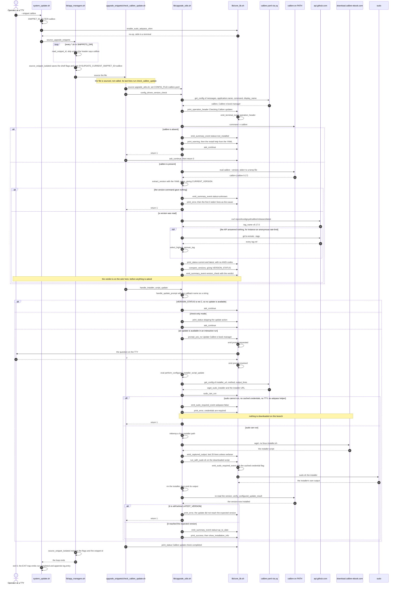
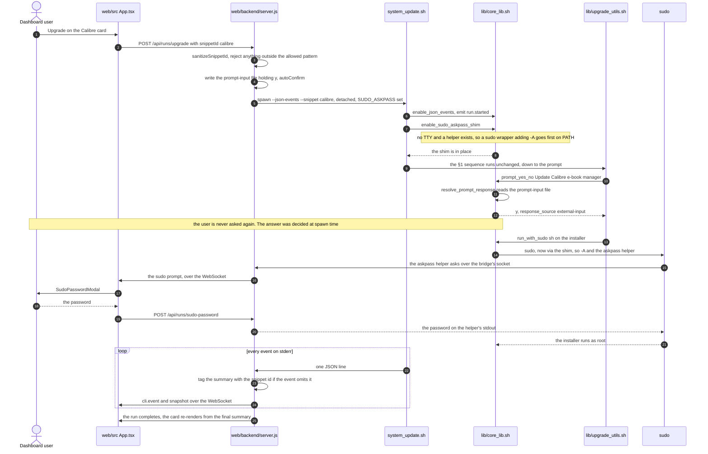

# sysupdate — UML sequence diagram: update the Calibre app

```
┌──────────────────────────────────────────────────────────────────────────────────────────┐
│ Name         uml-sequence-diagram-calibre                                                │
│ Type         UML sequence diagram — runtime ordering, extracted from source and one run  │
│ Project      sysupdate                                                                   │
│ Description  What happens in what order when sysupdate updates Calibre, and what has     │
│              already left the process by the time each decision is taken: the snippet is │
│              sourced rather than called, the GitHub verdict is on the event wire before  │
│              the operator is asked anything, sudo is probed before the installer is      │
│              fetched, and the installed version is re-read afterwards. Two paths are     │
│              drawn: the terminal path and the web-dashboard path. Extracted from         │
│              scripts/ and web/backend/ at commit bf1c1e8.                                │
└──────────────────────────────────────────────────────────────────────────────────────────┘
```

## Read this first: why a sequence diagram, and which of three paths is drawn

The claim this document is about is an **ordering** claim, so the notation that carries it is a
sequence diagram with lifelines. Three facts about the Calibre feature are facts about order, and
no dataflow or class diagram can express any of them:

- the snippet is **not called** — `source_upgrade_snippets` *sources* the file, and the file runs
  itself on its last line, so the orchestrator never holds a handle to `check_calibre_update`;
- the `summary.updates` verdict for Calibre **has already left the process** before the operator
  is asked whether to update (measured below: event 7 precedes events 8–9);
- the sudo probe happens **before** the installer download, deliberately, so a non-interactive run
  does not fetch a file it cannot install.

`source_upgrade_snippets` has three call sites in the orchestrator, so the Calibre check is
reached by three paths:

| Path | Entry | `scripts/system_update.sh` |
|---|---|---|
| **drawn, §1** | `--snippet calibre` | [`:507–510`](../../scripts/system_update.sh#L507) — package-manager work skipped entirely |
| **drawn, §2** | dashboard button → `--snippet calibre` via the bridge | same site, spawned by [`web/backend/server.js`](../../web/backend/server.js#L700) |
| not drawn | a full run (`./scripts/system_update.sh`), or `--check-only` with **no** snippet filter | [`:536`](../../scripts/system_update.sh#L536), [`:561`](../../scripts/system_update.sh#L561) — identical from the `source_snippet_isolated` message onward, with 47 other snippets around it |

The third path differs from §1 only in what surrounds it, which is why it is not redrawn. The
`--check-only` variant is drawn as an `alt` branch inside §1, because it changes the ordering: the
prompt is never reached.

## 1. The terminal path: `./scripts/system_update.sh --snippet calibre`



### What the ordering shows that a structural diagram cannot

**The snippet is sourced, not invoked.** `source_snippet_isolated` exists because of that: the
snippet runs in the orchestrator's own shell, so a `set -u` it turns on would stay on for every
later snippet and for `system_update.sh` itself. The function saves `$-` and `pipefail` around the
`source` and puts them back — and the comment above it records the run that died inside the sdkman
snippet for exactly this reason. In a call-based plugin system this message would not exist.

**The callback is a string, resolved by `eval`.** `handle_installer_script_update` passes the
*name* `perform_configured_installer_script_update` to `handle_update_prompt`, which runs it with
`eval "$update_callback"` only after the prompt is answered. So the edge from the prompt to the
installer is a dynamic one: no static reader of `handle_update_prompt` can see where it goes, and
the reachability probe in §3 only finds it because the name appears as a literal in the caller.

**Sudo is probed before the download, not after.** For `method: wget_sudo_installer`,
`perform_configured_installer_script_update` calls `sudo_can_run` *before* `mktemp` and `wget`.
In a non-interactive context with no cached credentials and no askpass helper, the run emits
`sudo.required` and returns 1 having fetched nothing. Two tests hold the order, and the first
asserts the negative with a sentinel file rather than asserting on output alone.

**The verdict precedes the question.** This is the measured trace of a real read-only run on this
host at `bf1c1e8` (`--snippet calibre --check-only --json-events`, exit 0):

| seq | event | source attribution | payload |
|---|---|---|---|
| 1 | `run.started` | `system_update.sh:emit_run_lifecycle_event` | |
| 2 | `terminal.line` | `system_update.sh:main` | section header |
| 3 | `terminal.line` | `check_calibre_update.sh:check_calibre_update` | `Checking Calibre updates...` |
| 4–5 | `terminal.line` | same | `Current version: 9.17`, `Latest version: 9.17.0` |
| 6 | `terminal.line` | same | `Calibre e-book manager is up to date` |
| **7** | **`summary.updates`** | same | `snippet_id: calibre`, `status: up_to_date` |
| **8–9** | **`prompt.requested` / `prompt.resolved`** | same | `continue`, resolved `check-only-default` |
| 10–12 | `terminal.line` | `check_calibre_update.sh:source`, then `app_managers.sh:source_upgrade_snippets` | the completion and separator lines |
| 13–14 | `run.completed`, `log.entry` | `system_update.sh` | |

Event 7 before events 8–9 is the ordering claim, and it is why the dashboard can render a Calibre
card the moment the check finishes without waiting for the run to end.

The trace also shows a limit of the event stream as evidence: `resolve_event_source` attributes
every event between 3 and 9 to `check_calibre_update.sh:check_calibre_update`, the snippet file and
its outermost function — not to `upgrade_utils.sh:compare_and_report_versions`, which actually
emitted event 7. **The internal lifelines of §1 are not recoverable from the events**; they come
from the call graph in §3. A reader who tried to verify §1 from a JSON trace alone would see four
participants, not eleven.

## 2. The dashboard path: the same snippet, spawned by the bridge

The dashboard's Calibre card is wired to the same snippet — `web/src/App.tsx` maps the summary
target `Calibre e-book manager` to `snippetId: 'calibre'` — but three things about the ordering
change, and each one exists because there is no terminal.



Three differences from §1, each an ordering difference rather than a structural one:

1. **The confirmation is answered before the question is asked.** `startUpgradeRun` sets
   `autoConfirm: true`, so the bridge writes a prompt-input file at spawn time and
   `resolve_prompt_response` reads `y` out of it with `response_source: external-input`. The
   dashboard's single click *is* the confirmation; the `prompt.requested` event still goes out, and
   the dashboard uses it as progress rather than as a question.
2. **The sudo prompt travels the other way.** In §1 sudo reads the terminal. Here
   `enable_sudo_askpass_shim` puts a `sudo` wrapper first on `PATH` that adds `-A`, because
   sudo-rs refuses to fall back to `SUDO_ASKPASS` on its own. The password then flows
   helper → bridge → WebSocket → modal → `POST /api/runs/sudo-password` → helper stdout, which is
   why the CLI is blocked *inside* sudo while the modal is up.
3. **`check-only` and `upgrade` are different runs.** The card's version pair comes from an earlier
   check-only run's `summary.updates`; pressing Upgrade starts a second process. Nothing in the
   CLI carries state between the two — the upgrade run re-reads the installed version and re-asks
   GitHub from scratch.

## 3. The call graph behind §1, and its control

A sequence diagram is a set of claims about calls, so each lifeline and each message has to resolve
to a definition that the snippet actually reaches. Bash has no `ast` module, so the probe asks bash
itself: source the three libraries, slice the snippet at its last `}` so the definition half can be
sourced without the file running itself, then use `declare -f` to get every function body **as
bash's own parser normalised it**, and walk from the names appearing in the snippet's top-level
tail.

```
functions defined   107
roots (snippet top) check_calibre_update print_status
reachable            66
```

The first attempt at this probe counted its own braces instead of asking bash, reported
**43 functions defined and 10 reachable**, and looked plausible. `core_lib.sh::emit_event` builds
its JSON with `json_output="{"` — an unbalanced brace in a string — so the slice for that one
function ran to end of file and swallowed every definition after it. `handle_installer_script_update`
was simply absent from the name set, so no path could reach it, and the probe's silence read as a
clean answer. Hence the control, which the broken version would have failed:

```bash
cp scripts/upgrade_snippets/check_calibre_update.sh /tmp/ctl.sh
printf 'prompt_update_confirmation "Calibre"\n' >> /tmp/ctl.sh
```

`prompt_update_confirmation` is defined in `upgrade_utils.sh` and called from nowhere in the repo.
Appending one call to it must move the probe by exactly that one node — and does:

```
roots  ... + prompt_update_confirmation
reachable  66 -> 67
new node   prompt_update_confirmation   (its own callee prompt_yes_no was already reachable)
```

Two readings of the base set matter for this diagram:

- Every participant and every message in §1 resolves into the 66. The resolution is in §5.
- **`handle_deb_package_update` and `perform_configured_deb_package_update` are not in the 66**
  (`grep -c deb_package` over the probe output: 0). Calibre's YAML says
  `method: wget_sudo_installer`, so the `.deb` branch of `upgrade_utils.sh` is dead on this path
  and §1 must not draw it. A diagram that drew both update methods "for completeness" would be
  describing a config that does not exist.

## 4. What drawing this found

### 4.1 `calibre.yaml` declares a prompt that this path does not read

The config carries a prompt block:

```yaml
prompts:
  confirm_update:
    message: "Update Calibre?"
    type: "yes_no"
```

The string the operator actually sees is `Update Calibre e-book manager?`, built in
`upgrade_utils.sh::handle_update_prompt` (`:1427`) from `$APP_DISPLAY_NAME`, with no `get_config`
call anywhere near it:

```bash
if ! prompt_yes_no "Update $app_name?"; then
```

So editing `prompts.confirm_update.message` in `calibre.yaml` changes no output, and the diagram
could not draw a message for the key. It is not a defect — nothing misbehaves — but it is a config
surface that reads as live and, on this path, is not.

**The first measurement of this was scoped wrong, and the correction is the useful part.** The
probe was a grep for `prompts\.` over `scripts/lib/` and `scripts/*.sh`, which returns nothing —
and from that it is tempting to write "nothing reads it". Widened to all of `scripts/`, four
snippets read `prompts.*` keys of their own (`update_firefox.sh`, `update_gdb.sh`,
`update_hyprland.sh`, `update_nodejs_app.sh`), and one of them reads *this exact key*:

```
scripts/upgrade_snippets/update_nodejs_app.sh:146:    update_prompt=$(get_config "prompts.confirm_update.message")
```

So `prompts.confirm_update` is live — in a snippet that drives its own prompt instead of going
through `handle_update_prompt`. Four YAMLs declare it (`calibre`, `cursor`, `nodejs_app`,
`postman`) and exactly one of the four has a reader. The narrow, true statement is: **the shared
framework never reads it, so the three config-driven snippets that declare it carry a dead key**,
and Calibre is one of them.

The companion to it is `upgrade_utils.sh::prompt_update_confirmation` (`:618`), a two-line wrapper
around `prompt_yes_no "Update $app_name?"` that would have been the natural reader. It has no
callers anywhere in the repo, which is what made it a usable control in §3.

### 4.2 The same event field is a JSON number or a JSON string depending on the version

From the measured trace, one `summary.updates` object:

```json
{"summary_name":"version_check","snippet_id":"calibre","target":"Calibre e-book manager",
 "status":"up_to_date","current_version":9.17,"latest_version":"9.17.0"}
```

`current_version` is a **number**, `latest_version` a **string**, in the same event. The cause is
`core_lib.sh::json_value`, which emits a bare token for anything matching
`^-?[0-9]+([.][0-9]+)?$`: Calibre's two-segment `9.17` matches, the three-segment `9.17.0` does not.
Any two-segment version does this — and §1's `alt` for the GitHub fallback can produce one on
either side.

This is currently harmless at the one consumer that reads the field:
`web/src/App.tsx:363–366` coerces both with `String(...)` before building the `UpdateItem`, whose
`currentVersion` is typed `string` and whose `.trim()` in `web/src/updateCard.ts` would throw on a
number. The coercion is load-bearing and uncommented. A second consumer — the QuickShell widget,
or `jq` in a shell — would not have it.

Recorded before any change: no fix is applied in this commit.

## 5. Node resolution — every participant and message of §1

Each label in the §1 and §2 blocks, resolved to the definition it names. **Line numbers are at
`bf1c1e8`**, not in the working tree: the three uncommitted separator lines described in §8 shift
every definition after them by one, which is how the first draft of this table got six of its
numbers wrong. §8 has the command that regenerates them.

| Label in the diagram | Resolves to |
|---|---|
| `system_update.sh` | [`scripts/system_update.sh`](../../scripts/system_update.sh) |
| `lib/app_managers.sh` | `source_upgrade_snippets` `:25`, `source_snippet_isolated` `:55`, `read_snippet_id` `:21` — [`app_managers.sh`](../../scripts/lib/app_managers.sh#L25) |
| `upgrade_snippets/check_calibre_update.sh` | `check_calibre_update` — [`:33`](../../scripts/upgrade_snippets/check_calibre_update.sh#L33), invoked at `:44` |
| `lib/upgrade_utils.sh` | `config_driven_version_check` `:153`, `get_config` `:54`, `get_current_version_from_config` `:114`, `extract_version` `:1373`, `check_app_installed_or_help` `:1354`, `check_app_installed` `:1309`, `compare_and_report_versions` `:1383`, `get_github_latest_version` `:291`, `get_github_latest_remote_tag_fallback` `:275`, `select_highest_semver_tag` `:266`, `handle_installer_script_update` `:1741`, `handle_update_prompt` `:1427`, `perform_configured_installer_script_update` `:1531`, `emit_captured_output` `:1465`, `verify_configured_update_result` `:1485` |
| `lib/core_lib.sh` | `print_operation_header` `:257`, `print_status` `:262`, `print_success` `:267`, `print_warning` `:272`, `print_error` `:277`, `emit_event` `:90`, `emit_terminal_event` `:132`, `emit_summary_event` `:149`, `json_value` `:58`, `prompt_yes_no` `:369`, `resolve_prompt_response` `:316`, `ask_continue` `:572`, `sudo_can_run` `:478`, `emit_sudo_required_event` `:482`, `enable_sudo_askpass_shim` `:510`, `run_with_sudo` `:546`, `compare_versions` `:649` |
| `calibre.yaml via yq` | [`scripts/upgrade_snippets/calibre.yaml`](../../scripts/upgrade_snippets/calibre.yaml); read only through `get_config`, which shells out to `yq -r` |
| `calibre on PATH` | not code in this repo — `/usr/bin/calibre` on the host, reached by `command -v` and `eval "$version_cmd"` |
| `api.github.com` | the URL literal in `get_github_latest_version`; `version.source: github` in the YAML selects it |
| `download.calibre-ebook.com` | `update.installer_url` in the YAML; no occurrence in any `.sh` |
| `sudo` | the host binary, or the generated wrapper in `$SYSUPDATE_STATE_DIR/askpass-shim/sudo` |
| `web/src App.tsx`, `web/backend/server.js` | `startUpgradeRun` `server.js:802`, `startRun` `server.js:691`, `resolveSnippetIdFromModule` `server.js:254`, `sanitizeSnippetId` `utils.js:57` (imported, used at `server.js:910` and `:929`) |
| `show_installation_info` | `upgrade_utils.sh:1814`; reached at the tail of `verify_configured_update_result` |

Two labels resolve to nothing in this repository on purpose — `calibre on PATH` and `sudo` are host
binaries, and `download.calibre-ebook.com` appears only as YAML data. That is the expected noise of
this probe, and the reason it is a list to read rather than a gate.

## 6. Claim → held by

| Claim in this document | Held by |
|---|---|
| a `--snippet calibre` run sources only that snippet | `tests/integration/cli_snippets.bats`: *"--snippet fixture-current only runs that snippet"*, *"--snippet fixture-outdated only runs that snippet"* |
| the summary carries `snippet_id: calibre` because the sourcing wrapper set it | `tests/bash/core_lib.bats`: *"emit_summary_event: tags the event with the running snippet's id"*, *"emit_summary_event: omits snippet_id outside a snippet"* |
| a filtered run tags the summary with the filtered id | `cli_snippets.bats`: *"a filtered run tags the summary with the filtered snippet id"* |
| sourcing a snippet cannot leak its shell options to the next one | `tests/bash/upgrade_utils.bats`: *"source_upgrade_snippets: a snippet's set -u does not leak to the caller"*, and the `set -e` and `pipefail` cases beside it, plus *"source_upgrade_snippets: nounset the caller already had is kept"* and *"source_upgrade_snippets: a leaked set -u cannot kill a later snippet"* |
| **the sudo probe precedes the download, and nothing is fetched when sudo cannot run** | `upgrade_utils.bats`: *"installer update: bails before download when sudo unavailable"* — asserts a `wget` sentinel file was never created — and *"installer update: proceeds to download when sudo credentials cached"* |
| check-only mode reaches no update callback | `tests/integration/cli_events.bats`: *"check-only mode does not invoke update callback for outdated fixture"* |
| the YAML is read through `get_config`, and a missing key is empty, not `null` | `upgrade_utils.bats`: *"get_config: reads a nested key"*, *"get_config: null yaml value returns empty and exits 1"*, *"get_config: missing key returns empty and exits 1"* |
| `extract_version` turns `calibre (calibre 9.17)` into `9.17` | `upgrade_utils.bats`: the six `extract_version:` cases — none of them uses Calibre's own regex |
| `9.17` and `9.17.0` compare equal, so the measured run is `up_to_date` | `tests/bash/core_lib.bats`: *"compare_versions: trailing zeros normalized (1.2.0 == 1.2)"*, *"normalize_version: strips single trailing zero"* |
| the `git ls-remote` fallback cannot return a non-semver tag | `upgrade_utils.bats`: the five `select_highest_semver_tag:` cases |
| sudo is judged runnable by cached credentials, a TTY, or an askpass helper | `core_lib.bats`: the four `sudo_can_run:` cases, plus *"run_with_sudo: fails without running command when no creds and no TTY"* |
| the askpass shim puts a `-A` wrapper first on PATH, once, and only with a helper | `core_lib.bats`: *"askpass shim: puts a sudo wrapper on PATH that adds -A"*, *"askpass shim: idempotent, PATH gains the shim dir once"*, *"askpass shim: no-op without SUDO_ASKPASS"* |
| a `snippetId` from the dashboard cannot reach the CLI unsanitised | `tests/backend/server.test.mjs`: the `sanitizeSnippetId` 400 cases |
| the dashboard's sudo round trip re-asks on rejection | `server.test.mjs`: *"relays the prompt to the dashboard, re-asks on rejection…"* |
| **the verdict event precedes the prompt events** | nothing — the measured trace in §1 is the only evidence, and no test asserts the order of `summary.updates` against `prompt.requested` |
| **Calibre's own `version.regex` extracts correctly** | nothing — no test names Calibre; see §8 |
| **`verify_configured_update_result` catches an installer that silently did not upgrade** | nothing for the installer-script path. The two `vscode-insiders:` verification cases exercise the same function through the `.deb` path |
| **`calibre.yaml`'s `prompts.confirm_update` reaches the operator** | nothing, and §4.1 shows it is false — the framework hardcodes the question |

Four rows have nothing behind them, which is the useful part of writing the table. Per
[`mutation-test-guards`](../guides/CODE_QUALITY_CONTROL_GUIDE.md), the rows that *do* name a test
are assumptions until someone has watched that test go red with its guard removed; that has not
been done for this document.

## 7. Deliberately not drawn

| Candidate | Why not |
|---|---|
| the full-run path (`./scripts/system_update.sh` with no flags) | identical to §1 from `source_snippet_isolated` onward. It differs only in the 47 other snippets around it and the apt/dpkg work before them, which is a different diagram's subject. |
| a sequence diagram per snippet | 48 snippets, and the config-driven ones share this exact sequence. The YAML differs; the order does not. `update.method` picks one of three branches in `perform_configured_installer_script_update`, and that is a **decision table**, not 48 sequence diagrams. |
| the `.deb` branch beside the installer branch | §3's probe shows `perform_configured_deb_package_update` is unreachable from this snippet. Drawing both methods would be drawing a config Calibre does not have. |
| a state machine for the run | the orchestrator has no states; the *bridge* does (`starting → running → completed/failed`, plus `paused`/`stopped`). That is a statechart of `web/backend/server.js`, worth drawing, and not about Calibre. |
| a class diagram | already drawn, and it found zero classes: see [`uml-class-diagram.md`](./uml-class-diagram.md). |
| the `yq` process boundary as its own lifeline | `get_config` forks `yq` once per key, which this diagram collapses into one `Yaml` participant. **Measured: 10 `yq` processes on the check-only path**, counted with a shim first on `PATH` (§8). That is a performance question, not an ordering one. |

## 8. Reproducing this

Everything above is from the shipped code at `bf1c1e8`. Three files on this path carry uncommitted
edits in the working tree — `scripts/lib/app_managers.sh`, `scripts/lib/core_lib.sh` and
`scripts/upgrade_snippets/check_calibre_update.sh` — and all three add only a
`print_status "---"` separator line. They change no call and no order; events 10–12 of the measured
trace are those lines. Diffing them is one command:

```bash
git diff -- scripts/lib/app_managers.sh scripts/lib/core_lib.sh scripts/upgrade_snippets/check_calibre_update.sh
```

The measured trace in §1, which is read-only and changes nothing on the host:

```bash
./scripts/system_update.sh --snippet calibre --check-only --json-events 2>/tmp/calibre-events.jsonl
```

```bash
python3 -I -c "import json,sys;[print(e['sequence'],e['event_type'],e['source']) for e in (json.loads(l) for l in open('/tmp/calibre-events.jsonl') if l.startswith('{'))]"
```

The three entry paths of the preamble:

```bash
git grep -n 'source_upgrade_snippets$' bf1c1e8 -- scripts/system_update.sh
```

The §4.1 finding. The narrow grep is the one that misleads, so run both and compare — the first
prints nothing, the second prints four snippets, one of which reads the exact key:

```bash
grep -rn 'prompts\.' scripts/lib scripts/*.sh
```

```bash
grep -rn 'prompts\.' scripts --include='*.sh'
```

```bash
grep -rn confirm_update scripts --include='*.sh'
```

And its orphaned would-be reader, which prints one path — a function with no callers appears in
exactly one file, its own:

```bash
grep -rlw prompt_update_confirmation scripts --include='*.sh'
```

The `yq` fork count in §7, with a counting shim ahead of the real binary on `PATH`:

```bash
d=$(mktemp -d); printf '#!/bin/sh\necho call >> %s/n\nexec %s "$@"\n' "$d" "$(command -v yq)" > "$d/yq"; chmod +x "$d/yq"; PATH="$d:$PATH" ./scripts/system_update.sh --snippet calibre --check-only >/dev/null 2>&1; wc -l < "$d/n"
```

The §4.2 typing quirk, straight from `json_value`:

```bash
bash -c 'source scripts/lib/core_lib.sh >/dev/null 2>&1; for v in 9.17 9.17.0; do echo "$v -> $(json_value "$v")"; done'
```

The §1 regex claim, against the real YAML:

```bash
bash -c 'source scripts/lib/upgrade_utils.sh >/dev/null 2>&1; extract_version "calibre (calibre 9.17)" "$(yq -r .version.regex scripts/upgrade_snippets/calibre.yaml)"'
```

The reachability probe and its control are described in §3. It sources the three libraries, splits
the snippet at its last `}` so the definitions can be sourced without the file running itself, reads
every body back with `declare -f`, and walks from the names in the snippet's top-level tail. The
control is the two-line append in §3: the reachable count must go from 66 to exactly 67, gaining
`prompt_update_confirmation` and nothing else.

Both mermaid blocks were **rendered**, not merely parsed, with mermaid 11.17.2 under jsdom in a
scratch directory outside this repository (so no devDependency lands here). The run:

```
blocks found 2
block 1  rendered  svg=85538B
block 2  rendered  svg=45325B
control broken block   RENDER FAILED  Parse error on line 3
control trivial block  rendered  svg=22332B
```

The broken control is what makes "rendered" falsifiable, and the harness also tests the SVG for
`aria-roledescription="error"`, because mermaid draws a syntax-error graph instead of throwing in
some cases. Eight labels the prose above cites — `source_snippet_isolated`,
`perform_configured_installer_script_update`, `sudo_can_run`, `verify_configured_update_result`,
`select_highest_semver_tag`, `emit_summary_event`, `SudoPasswordModal`, `sanitizeSnippetId` — were
each found in the resulting SVG. Because jsdom has no SVG layout and the harness stubs `getBBox`
with a guess from text length, this establishes that the blocks compile to SVG carrying the right
labels — **not** that their layout is legible in a browser.

Every test name this document quotes was resolved against the suites mechanically: flatten the
document's whitespace first (a cited name wraps inside a table cell, and `[^"]+` otherwise captures
the line break and the next line's indent), extract the quoted names, and look each up among the
354 `@test` names and 25 backend `it(...)` names. 21 citations, 0 unresolved. The first run of that
checker reported five failures, all of them citations written in the shortened form
that elides the test's prefix (an ellipsis standing in for `askpass shim:`) rather than its real
name; they are written out in full above.

Measured with GNU grep 3.12, GNU sed 4.9, Python 3.14.4, bash 5.x on Linux 7.0.0, git 2.53.0,
mermaid 11.17.2 and jsdom 31.0.0.

The §5 line numbers, regenerated at the pinned revision rather than from the working tree:

```bash
git show bf1c1e8:scripts/lib/upgrade_utils.sh | grep -nE '^(config_driven_version_check|get_config|handle_update_prompt|perform_configured_installer_script_update|verify_configured_update_result)\(\)'
```
